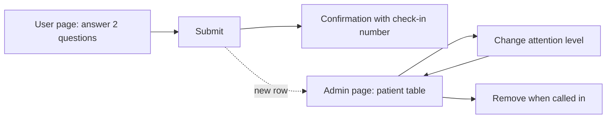

# Hospital Triage App - Design System

Author: Haotian Li (040961243)
Course: CST3106, Lab 10

This document describes the design system for the Hospital Triage app: the fonts, colors, components, layout and navigation, and how I keep them consistent. The app has two pages:

- **User page:** a patient in the waiting room answers two questions (type of injury and pain level) and submits them.
- **Admin page:** triage staff see every submission, sorted by how much attention each patient needs. They can change a patient's attention level and remove a patient from the list.

## 1. Fonts

| Font | Weights | Used for |
|---|---|---|
| Atkinson Hyperlegible Next | 400, 600, 700, 800 | All text: titles, questions, buttons, body text |
| Atkinson Hyperlegible Mono | 400, 600 | Numbers: check-in numbers (A-014), pain scores, wait times, counts |

Both fonts are free from Google Fonts and will be loaded with one `@import` line at the top of the stylesheet. If they fail to load, the page falls back to Arial and Courier New.

| Weight | Where I use it |
|---|---|
| 400 Regular | Body text, descriptions, answer options that are not selected |
| 600 SemiBold | Links in the top bar |
| 700 Bold | Questions (legends), labels, buttons, selected options, table headings |
| 800 ExtraBold | Page titles only |

Sizes: titles 36px (28px on phones), section headings 24px, body text 18px, small notes and badges 16px. The body is 18px instead of the usual 16px because many patients will be older, in pain, or without their glasses.

**Why these fonts.** Atkinson Hyperlegible was made by the Braille Institute for readers with low vision. Letters that look alike in most fonts are drawn differently, for example capital I, lowercase l and the number 1, or the letter O and the number 0. In a waiting room people read the screen while stressed, so I picked a font made for legibility over a decorative one. I use only one family for text, and the weight shows what is important (title, question, answer), so the pages look calm and simple.

The Mono version is used for numbers because every digit has the same width. In the admin table the check-in numbers and wait times line up in a column, which makes the list faster to scan. The zero has a slash, so A-010 can't be read as A-O1O.

## 2. Color Palette

All text and background pairs pass WCAG AA contrast (4.5:1 or more). I checked them with a contrast calculator.

### Shared colors (both pages)

| Name | Hex | Used for |
|---|---|---|
| Ink | `#1F2933` | Main text (14.8:1 on white) |
| Muted | `#52606D` | Placeholder text, small notes (6.5:1) |
| Line | `#7B8794` | Borders of inputs and options (3.7:1, enough for controls) |
| Divider | `#CBD2D9` | Card borders and table lines (decoration only) |
| Page | `#F5F7FA` | Page background |
| White | `#FFFFFF` | Cards, form, table |

### User page

| Name | Hex | Used for |
|---|---|---|
| Calm Blue | `#1F5FAD` | Top bar, title, Submit button, selected option border |
| Light Blue | `#E6F0FA` | Description box, selected option background |
| OK Green | `#2F7D4F` | Border of the "You are checked in" message |
| Light Green | `#E3F4EA` | Background of the "You are checked in" message |

Blue is the main color because it is calm and is used a lot in hospitals, which feels familiar. Patients are already worried, so the user page has no red at all. Green only appears after Submit, to show that it worked.

### Admin page

| Name | Hex | Used for |
|---|---|---|
| Slate | `#243B53` | Top bar, title, table header |
| Alert Red | `#B42318` | Remove button |

The admin page uses dark slate instead of blue. It looks more serious, and staff can tell at a glance which page they are on.

### Attention levels

The five levels follow the Canadian Triage and Acuity Scale (CTAS), which Canadian emergency departments use. CTAS already gives each level a color, so staff will recognize them.

| Level | Name | Color | Text color |
|---|---|---|---|
| 1 | Resuscitation | Blue `#1D4ED8` | White |
| 2 | Emergent | Red `#C81E1E` | White |
| 3 | Urgent | Yellow `#F5C518` | Ink |
| 4 | Less urgent | Green `#2E7D32` | White |
| 5 | Non-urgent | White `#FFFFFF` with a gray border | Ink |

A badge always shows the **number and the word** as well as the color, so a color-blind user can still read the level. Yellow and white use dark text because white text on them would fail the contrast check.

The attention level is only shown on the admin page. Patients only see their check-in number, because a level can change while they wait.

## 3. App Components

### Titles
- User page: "Hospital Triage - User". Admin page: "Hospital Triage - Admin".
- Large (36px, weight 800) and centered, in the page's main color, so it's clear which page is open.

### Description
- A box under the title on both pages, with a thick left border in the page color.
- User page: how to fill in the form, and a bold line telling people with chest pain, trouble breathing or heavy bleeding to go to the front desk instead of waiting for the form.
- Admin page: how the list is sorted and what the controls do.

### User questionnaire (user page)
- Two questions, each in a `fieldset` with a `legend`, so screen readers read the question before the answers.
- **Injury type:** six large option buttons (Cut or bleeding, Broken bone or sprain, Burn, Head injury, Illness or fever, Other).
- **Pain level:** 0 to 10 in steps of two, with "0 = no pain" and "10 = worst pain" under the scale.
- The options are radio buttons inside big labels, so the whole box can be clicked or tapped, not just the small circle. The selected one gets a blue border, light blue background and bold text.
- **Name** text input, then **Submit**.
- Data flow: Submit sends the answers to the admin page, and the patient gets a check-in number.

### Input fields
- Label above the field (never only a placeholder, because the placeholder disappears when you type).
- 2px gray border, 12px padding, 8px rounded corners, full width.
- Placeholder text in Muted gray, for example "First and last name".

### Buttons
| Type | Look | Where |
|---|---|---|
| Primary | Calm Blue background, white bold text, full width | Submit |
| Secondary | White with blue border and blue text | Back, less important actions |
| Danger | White with red border and red text; fills red on hover | Remove (admin) |

All buttons are at least 48px tall (40px for Remove inside the table), so they're easy to hit on a touch screen. Remove is outlined instead of solid red, so a row full of Remove buttons doesn't look like an alarm.

### Confirmation message (user page)
- Shown after Submit, in Light Green with an OK Green border.
- Shows the check-in number in large Mono text, and explains that patients are seen by urgency, not arrival time.

### Admin summary (admin page)
- **Count cards:** one card per attention level, with the number of patients waiting and the level badge.
- **Patient table:** No., Name, Injury, Pain, Attention level, Waiting time, Remove.
- Sorted by attention level (1 first), then by longest wait.
- **Change level:** clicking a badge turns it into a dropdown with the five levels.
- **Remove:** takes the patient off the list once they are called in.

### Focus ring
Every link, button, input, select and option gets the same 3px yellow outline when reached with the keyboard (Tab key), so keyboard users always know where they are.

## 4. Layout and Navigation

### User page
```
+------------------------------------------------------+
| Emergency Department Check-in            Staff page  |  top bar
+------------------------------------------------------+
|              Hospital Triage - User                  |  title
|  +------------------------------------------------+  |
|  | Description / warning                          |  |
|  +------------------------------------------------+  |
|  +------------------------------------------------+  |
|  | 1. Injury type     [option] [option] [option]  |  |  questionnaire
|  | 2. Pain level      [0] [2] [4] [6] [8] [10]    |  |
|  | Your name          [______________________]    |  |
|  | [                   Submit                  ]  |  |
|  +------------------------------------------------+  |
|  +------------------------------------------------+  |
|  | You are checked in. A-014                      |  |  after Submit
|  +------------------------------------------------+  |
+------------------------------------------------------+
```

- One column, at most 720px wide and centered. The questions go from top to bottom in the order they are answered, and Submit is the last thing on the page.
- On phones the option buttons wrap onto more lines, and the page padding gets smaller.

### Admin page
```
+------------------------------------------------------+
| Emergency Department Staff             Patient page  |  top bar
+------------------------------------------------------+
|              Hospital Triage - Admin                 |
|  [ Description                                    ]  |
|  Waiting now                                         |
|  [ L1 ] [ L2 ] [ L3 ] [ L4 ] [ L5 ]                  |  count cards
|  +------------------------------------------------+  |
|  | No. | Name | Injury | Pain | Level | Wait | X  |  |  patient table
|  +------------------------------------------------+  |
+------------------------------------------------------+
```

- Wider (up to 1100px) because the table has seven columns.
- On phones the count cards go two per row and the table scrolls sideways inside its box, so the page itself never scrolls sideways.

### Navigation flow



- The patient never leaves the user page. Everything happens on one screen, which matters when someone is in pain and doesn't want to click through several pages.
- Staff also stay on one page. The most urgent patient is always at the top, so the next person to call is always in the same place.
- The top bar has a link between the two pages while the app is being built. In the real app the admin page would need a staff login.

## 5. Consistency

- **One source for colors and fonts.** Every color and font in section 1 and 2 will be a CSS variable in `:root`, for example `--calm-blue: #1F5FAD;`, and the pages will use `var(--calm-blue)` instead of a hex code. Changing a color in one place changes it everywhere.
- **One stylesheet for both pages.** The admin page will only add `class="admin"` to `<body>`, which swaps blue for slate. Buttons, inputs, cards and spacing are the same on both pages.
- **Same structure on both pages:** top bar, centered title, description box, then the main content.
- **Same sizes everywhere:** 8px rounded corners, 48px minimum button height, spacing in steps of 8px (8, 16, 24, 32).
- **Same meaning for each color:** blue or slate is the page's main action, green is success, red is a removing action, and the CTAS colors are only used for attention levels.
- **Same words:** the levels always use the same five names, and buttons say what they do ("Submit", "Remove") on every page.

## 6. Accessibility summary

- Contrast of all text is at least 4.5:1 (WCAG AA).
- Levels use a number and a word, not only a color.
- 18px body text and a font made for low vision.
- Large click and tap targets (at least 48px).
- Labels on every input, and `fieldset`/`legend` for each question.
- Visible focus ring for keyboard users.
