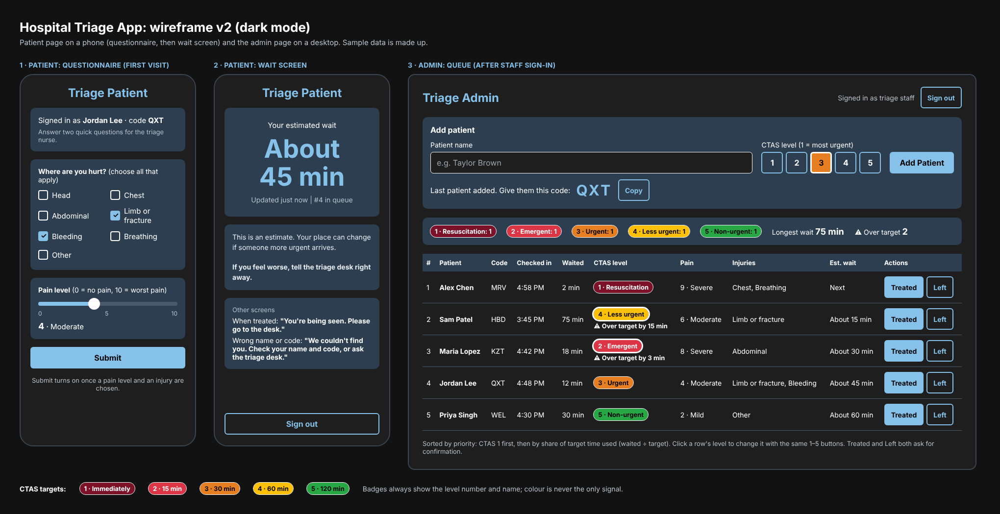

# Hospital Triage App Design System

## Design Overview

The Hospital Triage App provides separate interfaces for patients and administrative staff to manage the emergency room queue. The design focuses on clarity first: patients in distress should understand their wait at a glance, and staff should be able to scan and reprioritize the queue without hunting for information.

## Fonts

- **Inter** (via Bunny Fonts): used for all text in the app, chosen for its high legibility on screens and its clarity at both very small and very large sizes, which matters for the wait-time display.
- **Weight 700 (bold)**: page titles, buttons, the wait-time number, and severity badges.
- **Weight 400 (regular)**: body text, form labels, table content, and secondary information.

## Colour Palette

The palette is inherited from my ClinicConnect project (CST3102), which used the same primary blue on a white base.

- **Primary Blue `#2e86c1`**: primary buttons, headings, active states, and the wait-time number in light mode.
- **White `#ffffff`**: background of the user page in light mode.
- **Light Grey `#f0f0f0`**: admin page background and secondary surfaces (cards, table header) in light mode.
- **Black `#000000`**: default text colour and all borders in light mode.
- **Green `#28a745`**: success states and low-attention (green tier) badges.
- **Yellow `#ffc107`**: warning states and moderate-attention (yellow tier) badges.
- **Orange `#e67e22`**: high-attention (orange tier) badges.
- **Red `#dc3545`**: error states and critical-attention (red tier) badges, plus the remove action.

### Dark Mode

- **Backgrounds**: dark grey `#1e1e1e` for page backgrounds, `#2c3e50` for cards and the table header.
- **Primary Blue `#2e86c1`**: unchanged in dark mode.
- **Text**: white `#ffffff`, switching the previous black.
- **Severity colours**: unchanged; badge text is white or black depending on which is readable on that colour.

### Attention Level Tiers

The admin's attention-level slider (1 to 10) maps to four colour tiers so the queue can be scanned at a glance:

| Slider value | Tier | Colour |
| --- | --- | --- |
| 1 to 3 | Low | Green `#28a745` |
| 4 to 6 | Moderate | Yellow `#ffc107` |
| 7 to 8 | High | Orange `#e67e22` |
| 9 to 10 | Critical | Red `#dc3545` |

### Accessibility

Primary blue `#2e86c1` on white is approximately 3.6:1, which passes WCAG AA for large text (titles, buttons, the wait-time number) but not for small body text, so body text stays black on white. On dark backgrounds, white text on `#1e1e1e` and on `#2e86c1` both pass AA. Yellow badges use black text for the same reason.

## App Components

- **Titles**: "Triage User" on the patient page and "Triage Admin" on the staff page, bold Inter, centered at the top.
- **Sign-in form**: two stacked fields on the user page, one for the patient name and one for the three-letter code, each with placeholder text, plus a "Sign In" primary button.
- **Injury type selector**: checkboxes so the patient can select multiple applicable categories (head, chest, abdominal, limb or fracture, bleeding, breathing, other).
- **Pain level slider**: a slider from 1 to 10 with the current value displayed beside it.
- **Submit button**: primary blue, disabled until both a pain level and at least one injury type are selected, then becomes active.
- **Admin queue table**: a table listing each patient with columns for name, check-in time, pain level, injury types, attention tier badge, and wait estimate.
- **Attention level control**: a slider from 1 to 10 in each row, styled like the pain slider, which updates the row's tier badge colour live.
- **Remove button**: red, opens a confirmation dialog before the patient is removed from the queue.
- **Wait-time display**: the large bold wait estimate as the dominant element, and beneath it a small line showing last updated time, a pipe character, and the queue position (for example: "Updated 2 min ago | #4 in queue").

## Layout and Navigation

- Separate user and admin pages, each laid out mobile-first in a single column and widened into a centered container on desktop.
- The patient flow is: sign-in form, then the page swaps in place to the wait screen (no redirect for now).
- The admin page is a header, then the queue table sorted by computed priority, which combines the attention level and time already in the queue.

## Consistency

- Both pages share the same font, button style, border colour, and tier badge component, so a control behaves and looks the same everywhere it appears.
- The slider component is reused for both pain level and attention level, with identical behaviour and different labels.
- The tier colours, once defined, are the only colours used for status anywhere in the app.
- Terminology is consistent: "patient" for people in the queue, "attention level" for the admin-set priority value.

## Component Integration

- The sign-in form, injury checkboxes, and pain slider feed the submit button's enabled state, so the patient cannot submit an incomplete questionnaire.
- On the admin page, each row's attention slider and tier badge stay in sync, and the remove button's confirmation prevents accidental queue changes.
- The wait-time display reads the same queue data the admin page manages, so the two pages always present consistent information.

## Functionality

- The design emphasizes clarity: every screen answers "what do I do next" for the patient and "who needs attention first" for the admin with no extra steps.
- Patients submit their injury and pain information quickly, staff see a priority-sorted queue with colour-coded urgency, and both views update from the same data.
