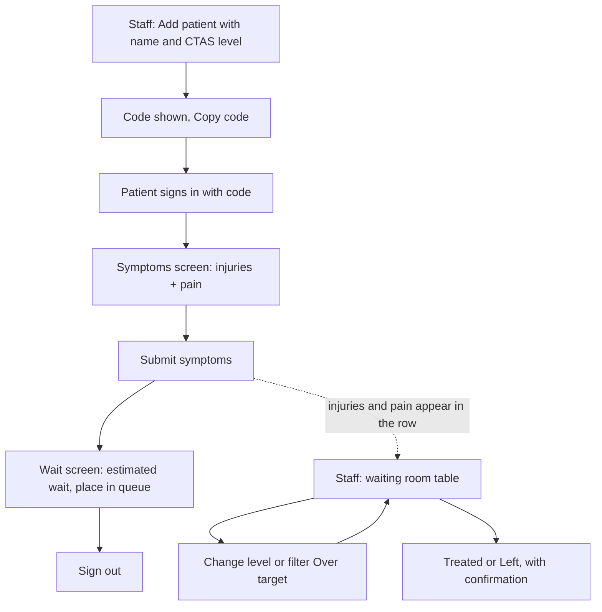

# Hospital Triage App - Design System

Author: Haotian Li (040961243)
Team members: none, I worked alone
Course: CST3106, Lab 10

This document describes the design system for the Hospital Triage app: fonts, colors, components, layout and navigation, and how I keep them consistent. It is meant to guide the development of the app, so every value here (font, weight, hex code) is what the code should use.

The app has two sides:

- **Patient (phone):** a patient in the waiting room signs in with a 3-letter code from the triage desk, says where they are hurt and how much pain they are in, and then sees their estimated wait.
- **Staff (desktop):** triage staff add patients, give them their code, and manage the waiting room queue sorted by CTAS level and wait time.

| Patient: symptoms | Patient: wait |
|---|---|
|  |  |


## 1. Fonts


The whole app uses one font: **Inter** (free on Google Fonts). If it fails to load, the app falls back to the system sans-serif font.

| Weight | Where I use it |
|---|---|
| 400 Regular | Descriptions and helper text ("Two quick questions for your triage nurse.", "Choose all that apply.") |
| 500 Medium | Option labels (Head, Chest, Limb or fracture), table cells |
| 600 SemiBold | Buttons, small uppercase labels (PATIENT CHECK-IN, STAFF WORKSPACE), table headers, CTAS badges |
| 700 Bold | Page titles ("Tell us how you feel", "Patient queue"), question titles, big numbers (45, QXT, pain level 4) |

Sizes: page titles about 40px, question titles about 28px, body and options about 20px on the phone, helper text about 16px. The most important number on each screen (the wait time, the pain level, the code) is the biggest thing on that screen.

**Why Inter.** Inter was designed for screens, so it stays clear at small sizes and on phones. Its numbers are wide and easy to tell apart, which matters in this app because so much of it is numbers: codes, pain levels, wait times, check-in times. I use only one font so the app looks calm and simple, and I use weight and size to show what is important instead of mixing fonts. The small uppercase labels with letter spacing (PATIENT CHECK-IN) tell the user where they are without competing with the title.

## 2. Color Palette


The app uses a **dark theme**. A waiting room is often dim and patients look at their phones for a long time, so a dark screen is easier on the eyes and on tired or sore patients. All text colors pass WCAG AA contrast (4.5:1 or more); I checked each pair with a contrast calculator.

### Base colors (both pages)

| Name | Hex | Used for |
|---|---|---|
| Night | `#0B121A` | Page background |
| Panel | `#131F2B` | Cards, form, table, staff header |
| Raised | `#1C303C` | Elements on top of a card (code chip, "#4 in queue" bar) |
| Border | `#293A49` | Card, option and input borders |
| Text | `#F2F6FA` | Main text (15.4:1 on Panel) |
| Muted text | `#A5B6C7` | Descriptions, helper text, labels (8.0:1 on Panel) |

### Accent and states

| Name | Hex | Used for |
|---|---|---|
| Mint | `#64DDC5` | Logo, main buttons (Submit symptoms, Add patient), small labels, the code, selected checkbox, pain slider, "Live" status |
| Mint ink | `#092A25` | Text on mint buttons (9.3:1) |
| Mint selected | `#14382F` | Background of a selected option and of the wait circle |
| Warning panel / Warning text | `#30291F` / `#F7D69B` | "Feeling worse?" box on the wait screen |
| Over target | `#FFC2A8` | Wait times and notes for patients waiting longer than their CTAS target |

**Patient side:** mint on dark blue-gray. Mint reads as "health" and "go" without being as loud as bright green, and the patient side uses no red at all so it doesn't add to anyone's stress. The only warm color is the "Feeling worse?" box, so it stands out as the one thing to act on.

**Staff side:** the same base and mint, so it is clearly the same app, but the staff page adds the CTAS level colors and the orange "over target" color. These are the only places with strong warm colors, so problems jump out of an otherwise calm screen.

### CTAS level colors (staff page only)

The five attention levels come from the **Canadian Triage and Acuity Scale (CTAS)**, the scale Canadian emergency departments use. Each level has a dark tinted background with light text in the same color family.

| Level | Name | Target | Background | Text |
|---|---|---|---|---|
| 1 | Resuscitation | Immediately | `#3B202B` | `#FFACB8` |
| 2 | Emergent | 15 min | `#3D252C` | `#FFACB6` |
| 3 | Urgent | 30 min | `#392E23` | `#FFCA89` |
| 4 | Less urgent | 60 min | `#363322` | `#F5DE8E` |
| 5 | Non-urgent | 120 min | `#21382D` | `#A3DDB2` |

The colors go from red (most urgent) to green (least urgent), which most people read correctly without a legend. **Levels are always labeled with the number and the name**, so color is never the only signal, and a color-blind user can still read the level.

Patients never see their CTAS level, only their place in the queue and their estimated wait, because the level is a clinical decision and can change while they wait.

## 3. App Components

### Header
- Mint square logo with a plus sign and the word "Triage" on both sides, so both are clearly the same app.
- Patient: a small mint label (PATIENT CHECK-IN) above the page title.
- Staff: a header bar with STAFF WORKSPACE, "Signed in as triage staff" and a Sign out button.

### Titles and descriptions
- One large bold title per screen that says what to do or what happened: "Tell us how you feel", "You're checked in", "Patient queue".
- One line of muted text under it ("Two quick questions for your triage nurse.") so the user knows how long the task is before starting.

### Patient sign-in card
- Shows the patient's name and their code (QXT) in a chip, so they can confirm it's them before answering.

### Questions
- Numbered in mint (01, 02) so the patient sees there are exactly two steps.
- **Where are you hurt?** Seven large checkbox options in a two-column grid (Head, Chest, Abdominal, Limb or fracture, Bleeding, Breathing, Other). It is "choose all that apply" because injuries often come together, for example a fracture with bleeding. The whole option box is clickable, not just the small square, and a selected option gets a mint border, mint check and dark green background, so the choice is visible from a distance.
- **How much pain are you in?** A slider from 0 to 10 with "0 · No pain" and "10 · Worst pain" at the ends. The chosen number is shown large with a word next to it (Mild, Moderate, Severe), so the patient doesn't have to guess what a number means.

### Buttons
| Type | Look | Examples |
|---|---|---|
| Primary | Solid mint, dark text, full width on phone | Submit symptoms, Add patient |
| Positive action | Dark green with mint text | Treated |
| Secondary | Dark with a thin border | Sign out, Left, Copy code |
| Level picker | Five square buttons 1 to 5; the selected one fills with its CTAS color | CTAS level in Add patient |

Buttons are at least 48px tall so they're easy to tap. On the patient form, Submit stays disabled until an injury and a pain level are chosen, and the text under it says so ("Select an injury and pain level to continue."), so the patient always knows why the button doesn't work. On the staff page, **Treated** and **Left** ask for confirmation, because removing someone from the queue by mistake is serious.

### Input fields
- Label above the field ("Patient name"), dark field with a border, and an example placeholder ("e.g. Taylor Brown"). The label stays visible while typing, unlike a placeholder.

### Wait screen
- **Estimated wait:** a large circle with "About 45 minutes". The word "About" and the box "A guide, not a guarantee" make it clear the number can change.
- **Queue position:** "#4 in queue" with "Updated just now", so the patient knows the information is live.
- **Feeling worse?** A warm-colored box telling the patient to go to the triage desk if their symptoms change. This is a safety message, so it uses the only warm color on the patient side.
- **Sign out** at the bottom, out of the way.

### Staff summary cards
- One card per CTAS level with the level name in its color, the number of patients waiting, and the target time (Immediately, 15 min target...).

### Add patient panel
- Patient name, CTAS level picker and Add patient button in one row, because staff do this many times a shift.
- On the right, "LAST PATIENT ADDED" shows the new code large in mint with a **Copy code** button, so staff can give the code to the patient right away.

### Waiting room table
- Above the table: **Longest wait** and **Over target** count, plus two filter tabs: All patients and Over target.
- Columns: #, Patient, Code, Checked in, Waited, CTAS level, Pain, Injuries, Est. wait, Actions.
- **Sort order:** level 1 is always first and marked "Next". After that, patients are sorted by how close they are to (or how far past) their CTAS target. That is why Sam Patel (level 4, 15 min over target) is above Maria Lopez (level 2, 3 min over target) in the example.
- Patients past their target show the wait time in orange and a note under the badge ("Over target by 15 min").
- A legend at the bottom lists the CTAS targets and says "Levels are labeled - color is never the only signal" and "Treated and Left require confirmation."

## 4. Layout and Navigation

### Patient side (phone, 390px wide)

```
+---------------------------+      +---------------------------+
| [+] Triage                |      | [+] Triage                |
| PATIENT CHECK-IN          |      | PATIENT CHECK-IN          |
| Tell us how you feel      |      | You're checked in         |
| Two quick questions...    |      | Jordan Lee - Code QXT     |
| +-----------------------+ |      | +-----------------------+ |
| | Jordan Lee      [QXT] | |      | |  YOUR ESTIMATED WAIT  | |
| +-----------------------+ |      | |        ( 45 )         | |
| 01 Where are you hurt?    |      | | #4 in queue   Updated | |
| [ ] Head    [ ] Chest     |      | +-----------------------+ |
| [ ] Abdom.  [x] Limb      |      | | A guide, not a guar.. | |
| [x] Bleed.  [ ] Breathing |      | +-----------------------+ |
| [ ] Other                 |      | | Feeling worse?        | |
| 02 How much pain?         |      | +-----------------------+ |
| | 4 Moderate  ---o------ ||      | [        Sign out       ] |
| [   Submit symptoms     ] |      |                           |
+---------------------------+      +---------------------------+
      Symptoms screen                     Wait screen
```

- One column, top to bottom in the order the patient works through it. The main button is the last thing on the screen, where the thumb reaches.
- The two injury columns keep all seven options visible without scrolling far.

### Staff side (desktop)

```
+------------------------------------------------------------------+
| [+] Triage  STAFF WORKSPACE        Signed in as staff [Sign out] |
+------------------------------------------------------------------+
| Patient queue                                   * Live - Updated |
| [ L1 ] [ L2 ] [ L3 ] [ L4 ] [ L5 ]     count + target per level   |
| +--------------------------------------------------------------+ |
| | Add patient: [name......] [1][2][3][4][5] [Add] |  Code QXT   | |
| +--------------------------------------------------------------+ |
| Waiting room          Longest wait 75 min    Over target 2       |
| [All patients 5] [Over target 2]                                 |
| +--------------------------------------------------------------+ |
| | # | Patient | Code | In | Waited | Level | Pain | ... | T | L | |
| +--------------------------------------------------------------+ |
| CTAS targets legend                                              |
+------------------------------------------------------------------+
```

- Read from top to bottom: overview (counts), action (add a patient), detail (the queue). The most urgent patient is always in the first row.

### Navigation flow



- The patient only ever sees two screens, and there is no menu to get lost in. After Submit the app moves to the wait screen by itself.
- The staff page is a single screen: everything a triage nurse needs is visible at once, and the next patient is always in the same place (row 1).
- Staff sign-in and patient codes keep the two sides separate: a patient can't open the staff page.

## 5. Consistency

- **One font, four weights.** Every screen uses Inter, and each weight always means the same thing (400 description, 500 option, 600 button/label, 700 title/number).
- **One palette.** Both sides use the same Night, Panel, Border, Text and Mint colors. In the code these will be CSS variables in `:root` (for example `--mint: #64DDC5;`) and the pages will use `var(--mint)` instead of hex codes, so changing a color changes it everywhere.
- **Each color has one meaning.** Mint = main action or selected; warm yellow/orange = needs attention (Feeling worse, Over target); the CTAS colors are only used for levels.
- **Same shapes.** Cards, options, buttons and badges all use the same rounded corners and the same thin border, and spacing goes in steps of 8px.
- **Same header and logo** on both sides, and the same small uppercase label style (PATIENT CHECK-IN, STAFF WORKSPACE, LAST PATIENT ADDED, YOUR ESTIMATED WAIT).
- **Same words everywhere.** The level names and the "1 · Resuscitation" format are the same in the summary cards, the level picker, the table and the legend. Pain is always "number · word" (4 · Moderate). The code is always three capital letters.

## 6. Accessibility

- Text contrast is at least 4.5:1 everywhere (most pairs are above 8:1).
- CTAS levels are always shown as number + name, never color alone.
- Large touch targets (at least 48px) and whole-box clickable options.
- Labels above inputs; the disabled Submit button explains what is missing.
- Confirmation before Treated and Left.
- Known weak spot: the borders (`#293A49` on `#131F2B`, about 1.4:1) are subtle. For the real app I'd make unselected option and input borders lighter (for example `#667E91`, which reaches 3.9:1, above the 3:1 WCAG asks for control borders) so the edges are easier to see for low-vision users.
