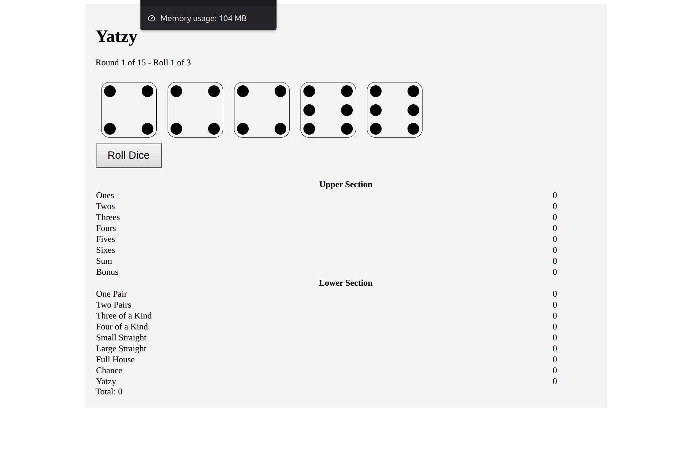
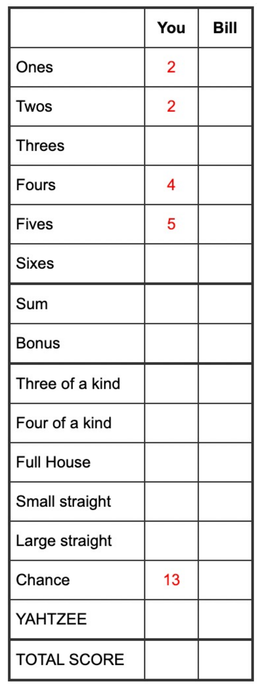

# Yatzy

CST3106 Lab 5 - Yatzy Game Design

Author: Haotian Li (040961243)

This lab is the design part of my Yatzy game. It has the rules, the design system, the dice design and a HTML/CSS mock-up of the game screen. The JavaScript for the game will be done in Assignment 1.

## Files

- `README.md` - game overview, rules, game flow
- `design_system.md` - colors, fonts and dice
- `design-system/index.html` - page that shows the colors, fonts and components
- `dice-design/` - dice CSS and a page with the 6 dice faces
- `yatzy-mock-up/` - mock-up of the game screen
- `score_card.png` - scorecard picture from the lecture 5 slides

## Game Overview

Yatzy is a dice game that is similar to Yahtzee. You roll 5 dice and try to get combinations to score points. My version is single player and has 15 rounds, one for each box on the scorecard. At the end the highest total score wins.

## How to Play

1. Roll all 5 dice.
2. Click the dice you want to keep. The other dice will be rolled again.
3. You can re-roll up to 2 more times, so 3 rolls per turn in total.
4. After rolling, pick one empty box on the scorecard and put your score there. If nothing fits you still have to pick a box and score 0.
5. Every box can only be used once. The game ends when all 15 boxes are filled.

## Scoring

The scorecard picture is from the lecture slides but it is a Yahtzee sheet, so it doesn't have One Pair and Two Pairs. My game uses the Yatzy rules below.

### Upper section

| Box | Score |
|---|---|
| Ones | add up all the 1s |
| Twos | add up all the 2s |
| Threes | add up all the 3s |
| Fours | add up all the 4s |
| Fives | add up all the 5s |
| Sixes | add up all the 6s |

If the upper section adds up to 63 or more you get a 50 point bonus.

### Lower section

| Box | What you need | Score |
|---|---|---|
| One Pair | 2 dice the same | sum of the pair |
| Two Pairs | 2 different pairs | sum of the 4 dice |
| Three of a Kind | 3 dice the same | sum of those 3 dice |
| Four of a Kind | 4 dice the same | sum of those 4 dice |
| Small Straight | 1-2-3-4-5 | 15 |
| Large Straight | 2-3-4-5-6 | 20 |
| Full House | 3 of a kind + a pair | sum of all dice |
| Chance | anything | sum of all dice |
| Yatzy | all 5 dice the same | 50 |

### Yatzy vs Yahtzee

The lecture also showed the Yahtzee rules. The main differences are: Yahtzee has no One Pair or Two Pairs, the bonus is 35 instead of 50, Full House is always 25, and the straights are worth 30 and 40.

## Game Flow

The layout follows the HTML structure from the lecture 5 slides. Everything is inside one `game-container`: the title, a message, the 5 dice, the Roll Dice button, the scorecard and the total at the bottom.

How a game goes:

1. The game starts at round 1 and the player clicks Roll Dice.
2. The player clicks the dice they want to keep and rolls again (max 3 rolls).
3. The player picks a box on the scorecard and the score goes in.
4. Sum, bonus and total update and the next round starts.
5. After round 15 the final score is shown with a message.

## Planned Interactions

These will be added with JavaScript in Assignment 1:

- Roll Dice button gives new random numbers to the dice that are not kept (using `Dice.roll()` and `Dice.showDie()` from the class sample `07_dice.js`)
- A short rolling animation like the one from the lecture 5 mini lab
- Clicking a die keeps it or un-keeps it
- Clicking a box on the scorecard saves the score
- The message at the top shows the round and roll number
- Message at the end of the game with the final score

## Design Notes

I used the CSS from the class sample `07_dice.css` and the lecture 5 slides instead of making my own style, because the Assignment 1 code will be built on the same sample code. More details are in `design_system.md`.

To view the mock-up, open `yatzy-mock-up/index.html` in a browser. It's only HTML/CSS for now, so the button doesn't do anything yet.

## References

- CST3106 Lecture 5 slides (Yatzy rules, HTML structure, styling)
- Class sample code js3 (`07_dice.css`, `07_dice.js`, `09_yatze.html`)
- https://en.wikipedia.org/wiki/Yatzy
- https://cardgames.io/yahtzee/
